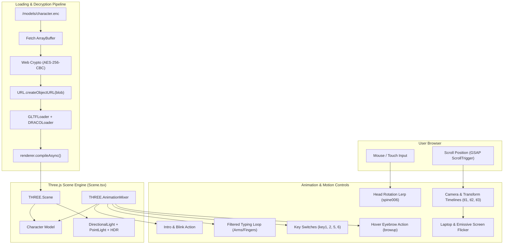

# 🧊 3D Model & Animation Architecture Guide

This document provides a comprehensive technical breakdown of how the **3D Avatar Model**, **Bone Rigging**, **Animation Mixer Pipeline**, **Interactive Controls**, and **Physics Engine** operate in this portfolio website.

---

## 📑 Table of Contents

1. [High-Level Architecture Overview](#1-high-level-architecture-overview)
2. [The 3D Model: Assets, Security & Loading Pipeline](#2-the-3d-model-assets-security--loading-pipeline)
   - [Asset Storage & Web Crypto Encryption](#asset-storage--web-crypto-encryption)
   - [GLTF Loading with Draco Mesh Compression](#gltf-loading-with-draco-mesh-compression)
   - [GPU Shader Pre-Compilation & Mesh Configuration](#gpu-shader-pre-compilation--mesh-configuration)
3. [Scene Setup, Camera & Lighting](#3-scene-setup-camera--lighting)
   - [WebGLRenderer & Color Management](#webglrenderer--color-management)
   - [PerspectiveCamera Configuration](#perspectivecamera-configuration)
   - [HDRI Environment & Dynamic Lighting](#hdri-environment--dynamic-lighting)
4. [Animation Systems & Control Mechanics](#4-animation-systems--control-mechanics)
   - [Three.js AnimationMixer Core](#threejs-animationmixer-core)
   - [Selective Bone Animation Filtering (`filterAnimationTracks`)](#selective-bone-animation-filtering-filteranimationtracks)
   - [Typing & Keyboard Synchronized Loops](#typing--keyboard-synchronized-loops)
   - [Facial Interaction: Eyebrow Lift on Hover (`browup`)](#facial-interaction-eyebrow-lift-on-hover-browup)
   - [Intro Pose & Eye Blinking Sequence](#intro-pose--eye-blinking-sequence)
5. [User Input & Interactive Tracking](#5-user-input--interactive-tracking)
   - [Cursor & Touch Tracking (NDC Space)](#cursor--touch-tracking-ndc-space)
   - [Head Tracking & Clamped Rotation Lerping](#head-tracking--clamped-rotation-lerping)
6. [GSAP Scroll Choreography (`GsapScroll.ts`)](#6-gsap-scroll-choreography-gsapscrollts)
   - [Timeline 1: Landing to About Section](#timeline-1-landing-to-about-section)
   - [Timeline 2: About to Workspace Section (Laptop reveal)](#timeline-2-about-to-workspace-section-laptop-reveal)
   - [Timeline 3: What I Do Section Transition](#timeline-3-what-i-do-section-transition)
   - [Dynamic Screen Glow & Emissive Flickering](#dynamic-screen-glow--emissive-flickering)
7. [Secondary 3D Feature: Interactive TechStack Physics (`TechStack.tsx`)](#7-secondary-3d-feature-interactive-techstack-physics-techstacktsx)
   - [React Three Fiber + Rapier Physics Setup](#react-three-fiber--rapier-physics-setup)
   - [Zero-Gravity Central Gravity Simulation](#zero-gravity-central-gravity-simulation)
   - [Kinematic Mouse Pointer Deflector](#kinematic-mouse-pointer-deflector)
   - [Post-Processing (N8AO Screen Space Ambient Occlusion)](#post-processing-n8ao-screen-space-ambient-occlusion)
8. [File Structure & Key References](#8-file-structure--key-references)
9. [How to Customize or Replace the 3D Character](#9-how-to-customize-or-replace-the-3d-character)

---

## 1. High-Level Architecture Overview

The application features a hybrid 3D rendering architecture:
- **Imperative Three.js Engine (`src/components/Character/Scene.tsx`)**: Controls the main interactive avatar sitting at a desk, typing, tracking user mouse movements, and transforming synchronously with page scrolling.
- **Declarative React Three Fiber Engine (`src/components/TechStack.tsx`)**: Powers an interactive zero-gravity physics playground demonstrating technical skills using `@react-three/rapier`.



---

## 2. The 3D Model: Assets, Security & Loading Pipeline

### Asset Storage & Web Crypto Encryption

To safeguard custom 3D character models from direct scraping, the asset pipeline implements symmetric AES-CBC encryption:

1. **Offline Encryption (`public/models/encrypt.cjs`)**:
   - The raw GLB file (`character.glb`) is encrypted into `character.enc` via Node.js `crypto`.
   - Algorithm: **AES-256-CBC**.
   - Key derivation: `crypto.createHash("sha256").update("Character3D#@").digest()`.
   - Initialization Vector (IV): 16 random bytes prepended to the output file stream.

```javascript
// public/models/encrypt.cjs snippet
const key = crypto.createHash("sha256").update(password).digest();
const iv = crypto.randomBytes(16);
const cipher = crypto.createCipheriv("aes-256-cbc", key, iv);
output.write(iv);
input.pipe(cipher).pipe(output);
```

2. **Runtime Client Decryption (`src/components/Character/utils/decrypt.ts`)**:
   - When the client initializes, `decryptFile()` fetches `/models/character.enc`.
   - Extracts the first 16 bytes as the `iv`, and slices the remaining bytes as encrypted payload.
   - Uses the browser's native **Web Crypto API** (`window.crypto.subtle`) to derive the SHA-256 key and decrypt:

```typescript
// src/components/Character/utils/decrypt.ts
const iv = new Uint8Array(encryptedData.slice(0, 16));
const data = encryptedData.slice(16);
const key = await generateAESKey(password);
return crypto.subtle.decrypt({ name: "AES-CBC", iv }, key, data);
```

3. **Memory Object URL**:
   - The decrypted ArrayBuffer is converted into an in-memory blob:
     ```typescript
     const blobUrl = URL.createObjectURL(new Blob([encryptedBlob]));
     ```
   - This temporary URL is passed into `GLTFLoader`.

---

### GLTF Loading with Draco Mesh Compression

File loading is handled in `src/components/Character/utils/character.ts`:
- **DRACOLoader**: Utilizes Google Draco geometric compression (`/draco/` WebAssembly decoder) to decompress geometries on background workers without locking the main thread.
- **Resource Cleanup**: Once the model resolves, `dracoLoader.dispose()` is executed to free memory.

```typescript
const loader = new GLTFLoader();
const dracoLoader = new DRACOLoader();
dracoLoader.setDecoderPath("/draco/");
loader.setDRACOLoader(dracoLoader);
```

---

### GPU Shader Pre-Compilation & Mesh Configuration

To eliminate frame-rate stutter during the initial render:
1. **Async Shader Compilation**:
   ```typescript
   await renderer.compileAsync(character, camera, scene);
   ```
   All materials and shader programs are compiled on the GPU before the scene is displayed.

2. **Shadow & Frustum Optimizations & Material Styling**:
   The model hierarchy is traversed:
   - `child.castShadow = true` and `child.receiveShadow = true` ensure realistic lighting underneath the desk and character limbs.
   - `mesh.frustumCulled = true` prevents the GPU from drawing meshes outside the camera view frustum.
   - **Procedural Cartoon Material Styling**:
     - **Face & Head (`Plane.007`)**: Warm caramel skin tone (`#C58B68`), `roughness: 0.52`, `metalness: 0.02`.
     - **Ears, Neck & Hands (`Plane.003`, `Plane.005`, `Mesh.002`)**: Harmonized skin tone (`#C58B68`).
     - **Hoodie (`BODY.SHIRT`)**: Charcoal heather grey (`#3B3D42`), matte fabric `roughness: 0.88`.
     - **Hair & Eyebrows (`hair`, `Eyebrow`)**: Deep charcoal black (`#151515`).
     - **Pants (`Pant`)**: Midnight dark pants (`#1E2024`).
     - **Shoes & Soles (`Shoe`, `Sole`)**: Off-white sneakers (`#E8E8E8`) with dark soles (`#222224`).
     - **Eyes (`EYEs.001`)**: Custom eye iris texture map preserved intact.

3. **Initial Rig Correction**:
   ```typescript
   character.getObjectByName("footR")!.position.y = 3.36;
   character.getObjectByName("footL")!.position.y = 3.36;
   ```
   Grounds the avatar feet into realistic contact position with the floor.

---

## 3. Scene Setup, Camera & Lighting

### WebGLRenderer & Color Management
Configured in `src/components/Character/Scene.tsx`:
- **Canvas Container**: Mounted into `canvasDiv.current` (`.character-model`).
- **Alpha**: `true` allows transparent background, seamlessly blending with CSS gradient backgrounds (`.landing-circle1`, `.landing-circle2`).
- **Tone Mapping**: `THREE.ACESFilmicToneMapping` with exposure `1.0` delivers film-grade high-dynamic-range color reproduction.
- **Pixel Ratio**: Clamped to `window.devicePixelRatio` for sharp rendering on Retina/HiDPI screens.

### PerspectiveCamera Configuration
- **Field of View (FOV)**: Narrow `14.5°` FOV produces an isometric telephoto aesthetic, reducing perspective distortion.
- **Initial Coordinates**:
  ```typescript
  camera.position.set(0, 13.1, 24.7);
  camera.zoom = 1.1;
  camera.updateProjectionMatrix();
  ```

### HDRI Environment & Dynamic Lighting
Managed in `src/components/Character/utils/lighting.ts`:

1. **Equirectangular Environment Map**:
   - `char_enviorment.hdr` is loaded via `RGBELoader`.
   - Mapped as `THREE.EquirectangularReflectionMapping` for ambient reflections on metallic/smooth surfaces.
   - Rotated via `scene.environmentRotation.set(5.76, 85.85, 1)` to align reflections with the desk light source.

2. **Directional Light**:
   - Color: Soft lilac (`0xc7a9ff`).
   - Shadow map size: `1024x1024`.
   - Shadow camera bounds: `near: 0.5, far: 50`.

3. **Point Light & Laptop Screen Glow Sync**:
   - Position: `(3, 12, 4)` located immediately above the laptop.
   - Dynamically synchronized with the monitor screen mesh:
     ```typescript
     function setPointLight(screenLight: any) {
       if (screenLight.material.opacity > 0.9) {
         pointLight.intensity = screenLight.material.emissiveIntensity * 20;
       } else {
         pointLight.intensity = 0;
       }
     }
     ```

4. **Intro Fade-in (`turnOnLights`)**:
   - When loading completes, GSAP animates `scene.environmentIntensity` from `0` to `0.64` and `directionalLight.intensity` to `1` over 2 seconds, while animating the CSS `.character-rim` spotlight.

---

## 4. Animation Systems & Control Mechanics

The animation system operates via `src/components/Character/utils/animationUtils.ts`. It manages multiple concurrent clips through a single `THREE.AnimationMixer`.

```
                        ┌───────────────────────────────────┐
                        │       THREE.AnimationMixer        │
                        └─────────────────┬─────────────────┘
                                          │
       ┌──────────────────┬───────────────┴───────────────┬──────────────────┐
       ▼                  ▼                               ▼                  ▼
┌───────────────┐  ┌───────────────┐               ┌───────────────┐  ┌───────────────┐
│ introAnimation│  │ Blink (Fade)  │               │ Key Switches  │  │ Filtered Bone │
│  (Clamp Once) │  │  (Delay 2.5s) │               │(key1,2,5,6)   │  │   Actions     │
└───────────────┘  └───────────────┘               └───────────────┘  └───────┬───────┘
                                                                              │
                                                     ┌────────────────────────┴────────────────────────┐
                                                     ▼                                                 ▼
                                      ┌───────────────────────────────┐ ┌─────────────────────────────┐
                                      │   typing (Arms, Hands, Legs)  │ │ browup (eyebrow_L, eyebrow_R│
                                      │     Bone track filtering      │ │  Triggered on Face Hover    │
                                      └───────────────────────────────┘ └─────────────────────────────┘
```

---

### Selective Bone Animation Filtering (`filterAnimationTracks`)

A critical architectural feature of this codebase is **bone track isolation**. Normally, playing a GLTF animation overrides all bones in the skeleton, preventing procedural head tracking or layered gestures.

To solve this, `animationUtils.ts` extracts only the keyframe tracks that affect specific bones:

```typescript
const filterAnimationTracks = (
  clip: THREE.AnimationClip,
  boneNames: string[]
): THREE.AnimationClip => {
  const filteredTracks = clip.tracks.filter((track) =>
    boneNames.some((boneName) => track.name.includes(boneName))
  );

  return new THREE.AnimationClip(
    clip.name + "_filtered",
    clip.duration,
    filteredTracks
  );
};
```

---

### Typing & Keyboard Synchronized Loops

1. **Typing Action**:
   - Uses `typingBoneNames` from `src/data/boneData.ts` (over 50 bones covering fingers, thumbs, palms, forearms, shins, and feet).
   - Only these specific tracks are included in the typing action.
   - Played in an endless loop at `timeScale = 1.2` for snappy, realistic typing rhythm.
   - Because `spine006` (head) and `spine005` (neck) are excluded from the typing track filter, the head remains free to track the user's cursor without jitter!

2. **Mechanical Keyboard Animations**:
   - Separate clips: `"key1"`, `"key2"`, `"key5"`, `"key6"`.
   - Played at `timeScale = 1.2` alongside typing, depressing keyboard keys in sync with typing gestures.

---

### Facial Interaction: Eyebrow Lift on Hover (`browup`)

An interactive element tied to DOM cursor hover:
- A transparent HTML layer `<div className="character-hover">` is positioned directly over the 3D character's face.
- Target bones: `eyebrowBoneNames = ["eyebrow_L", "eyebrow_R"]`.
- When the user hovers over the face:
  ```typescript
  const onHoverFace = () => {
    isHovering = true;
    eyeBrowUpAction.reset();
    eyeBrowUpAction.enabled = true;
    eyeBrowUpAction.setEffectiveWeight(4);
    eyeBrowUpAction.fadeIn(0.5).play();
  };
  ```
- When mouse leaves:
  ```typescript
  const onLeaveFace = () => {
    isHovering = false;
    eyeBrowUpAction.fadeOut(0.6);
  };
  ```

---

### Intro Pose & Eye Blinking Sequence

- **`introAnimation`**: Plays once on initial startup with `setLoop(THREE.LoopOnce, 1)` and `clampWhenFinished = true`.
- **`startIntro()`**: Triggered 2.5 seconds after loading reaches 100%. Resets and executes `introAnimation`.
- **`Blink` animation**: Fades in with `.fadeIn(0.5)` after 2.5 seconds to establish an idle natural blinking cycle.

---

## 5. User Input & Interactive Tracking

Implemented in `src/components/Character/utils/mouseUtils.ts`.

### Cursor & Touch Tracking (NDC Space)
Mouse and touch positions are mapped to Normalized Device Coordinates (`[-1, 1]`):
```typescript
const mouseX = (event.clientX / window.innerWidth) * 2 - 1;
const mouseY = -(event.clientY / window.innerHeight) * 2 + 1;
```
For mobile touch events, `handleTouchEnd()` smoothly interpolates coordinates back to `(0, 0)` with a decay curve to gently return the character's head to center.

### Head Tracking & Clamped Rotation Lerping
Inside the `requestAnimationFrame` render loop:
```typescript
handleHeadRotation(
  headBone,
  mouse.x,
  mouse.y,
  interpolation.x,
  interpolation.y,
  THREE.MathUtils.lerp
);
```

**Rotation Logic**:
- Target Bone: `spine006` (the head bone).
- **Hero View (`scrollY < 200`)**:
  - **Yaw (Horizontal Rotation)**:
    `headBone.rotation.y = lerp(headBone.rotation.y, mouseX * (Math.PI / 6), 0.2)`
    Limits rotation to $\pm 30^\circ$ ($\pi / 6$ radians).
  - **Pitch (Vertical Rotation)**:
    Clamped between `minRotationX = -0.3` and `maxRotationX = 0.4` radians. The head follows vertical cursor movements without clipping through the neck or collar.
- **Scroll View (`scrollY >= 200`)**:
  When scrolled down into other portfolio sections, head tracking disengages and the head lerps to fixed focus coordinates:
  ```typescript
  headBone.rotation.x = lerp(headBone.rotation.x, -0.4, 0.03);
  headBone.rotation.y = lerp(headBone.rotation.y, -0.3, 0.03);
  ```

---

## 6. GSAP Scroll Choreography (`GsapScroll.ts`)

The 3D model transforms smoothly along with the scroll position via **GSAP ScrollTrigger** and **ScrollSmoother**.

### Timeline 1: Landing to About Section
```typescript
// Trigger: .landing-section | scrub: true
tl1
  .fromTo(character.rotation, { y: 0 }, { y: 0.7, duration: 1 }, 0)
  .to(camera.position, { z: 22 }, 0)
  .fromTo(".character-model", { x: 0 }, { x: "-25%", duration: 1 }, 0)
  .to(".landing-container", { opacity: 0, duration: 0.4 }, 0)
  .to(".landing-container", { y: "40%", duration: 0.8 }, 0);
```
- As the user scrolls away from the Hero:
  - Character rotates $0.7$ radians (~$40^\circ$).
  - Camera zooms closer ($z: 24.7 \rightarrow 22$).
  - Container shifts $-25\%$ left on desktop screens to leave room for the "About Me" biography.

### Timeline 2: About to Workspace Section (Laptop reveal)
```typescript
// Trigger: .about-section | scrub: true
tl2
  .to(camera.position, { z: 75, y: 8.4, duration: 6, delay: 2, ease: "power3.inOut" }, 0)
  .to(character.rotation, { y: 0.92, x: 0.12, delay: 3, duration: 3 }, 0)
  .to(neckBone.rotation, { x: 0.6, delay: 2, duration: 3 }, 0)
  .to(monitor.material, { opacity: 1, duration: 0.8, delay: 3.2 }, 0)
  .to(screenLight.material, { opacity: 1, duration: 0.8, delay: 4.5 }, 0)
  .fromTo(monitor.position, { y: -10, z: 2 }, { y: 0, z: 0, delay: 1.5, duration: 3 }, 0);
```
- The camera pans back ($z: 75, y: 8.4$) to reveal the broader workspace.
- The neck bone (`spine005`) tilts down ($x: 0.6$ radians) to look directly at the laptop.
- The laptop screen object (`Plane004` / `monitor`) lifts up into position from $y: -10$ to $0$ and fades in from opacity $0$ to $1$.
- The rim lighting scales down and disappears.

### Timeline 3: What I Do Section Transition
```typescript
// Trigger: .whatIDO | scrub: true
tl3
  .fromTo(".character-model", { y: "0%" }, { y: "-100%", duration: 4, ease: "none", delay: 1 }, 0)
  .fromTo(".whatIDO", { y: 0 }, { y: "15%", duration: 2 }, 0)
  .to(character.rotation, { x: -0.04, duration: 2, delay: 1 }, 0);
```
- Smoothly slides the entire 3D canvas off-screen ($y: -100\%$) as the user scrolls into Career and Work showcases.

### Dynamic Screen Glow & Emissive Flickering
To simulate dynamic monitor reflections on the character's face:
```typescript
let intensity = 0;
setInterval(() => {
  intensity = Math.random();
}, 200);

gsap.timeline({ repeat: -1, repeatRefresh: true }).to(screenLight.material, {
  emissiveIntensity: () => intensity * 8,
  duration: () => Math.random() * 0.6,
  delay: () => Math.random() * 0.1,
});
```
This random flicker updates `screenlight.material.emissiveIntensity`, which in turn modulates the Three.js `PointLight` intensity inside `setPointLight()` in real time.

---

## 7. Secondary 3D Feature: Interactive TechStack Physics (`TechStack.tsx`)

In addition to the main avatar, the site features a secondary 3D interactive module under `#work`:

### React Three Fiber + Rapier Physics Setup
- Uses `@react-three/fiber` with `@react-three/rapier`.
- 30 physics spheres textured with 8 tech icons (React, Next.js, Node.js, Express, MongoDB, MySQL, TypeScript, JavaScript).
- Materials: `MeshPhysicalMaterial` with metalness `0.5`, roughness `1.0`, and clearcoat `0.1`.

### Zero-Gravity Central Gravity Simulation
- World gravity is disabled (`gravity={[0, 0, 0]}`).
- Custom attraction impulse pushes each sphere toward the origin on every frame:
  ```typescript
  const impulse = vec
    .copy(api.current!.translation())
    .normalize()
    .multiply(
      new THREE.Vector3(
        -50 * delta * scale,
        -150 * delta * scale,
        -50 * delta * scale
      )
    );
  api.current?.applyImpulse(impulse, true);
  ```
  This creates an organic floating cluster effect.

### Kinematic Mouse Pointer Deflector
A hidden kinematic physics collider tracks the cursor across the 3D viewport:
```typescript
function Pointer({ vec = new THREE.Vector3(), isActive }: PointerProps) {
  useFrame(({ pointer, viewport }) => {
    if (!isActive) return;
    const targetVec = vec.lerp(
      new THREE.Vector3(
        (pointer.x * viewport.width) / 2,
        (pointer.y * viewport.height) / 2,
        0
      ),
      0.2
    );
    ref.current?.setNextKinematicTranslation(targetVec);
  });
  return (
    <RigidBody type="kinematicPosition" colliders={false} ref={ref}>
      <BallCollider args={[2]} />
    </RigidBody>
  );
}
```
When the user moves their cursor over the tech stack, the floating icons disperse and bounce off the cursor collider with realistic physical damping.

### Post-Processing (N8AO Screen Space Ambient Occlusion)
Rendered using `@react-three/postprocessing`:
```jsx
<EffectComposer enableNormalPass={false}>
  <N8AO color="#0f002c" aoRadius={2} intensity={1.15} />
</EffectComposer>
```
Adds soft ambient contact shadows between overlapping spheres with a subtle dark violet accent (`#0f002c`).

---

## 8. File Structure & Key References

| File Path | Description |
|---|---|
| `src/components/Character/Scene.tsx` | Main Three.js scene mounting, camera, render loop, resize observer, and event listeners. |
| `src/components/Character/utils/character.ts` | Model decryption trigger, GLTF + Draco decompression, shader compile, and rig adjustments. |
| `src/components/Character/utils/decrypt.ts` | Web Crypto API implementation for AES-256-CBC decryption. |
| `src/components/Character/utils/animationUtils.ts` | AnimationMixer management, track filtering, typing loop, hover action, and intro sequence. |
| `src/components/Character/utils/mouseUtils.ts` | Mouse and touch NDC calculation, clamped head bone lerp rotation. |
| `src/components/Character/utils/lighting.ts` | HDR environment loading, directional light, point light, and laptop screen sync. |
| `src/components/Character/utils/resizeUtils.ts` | Aspect ratio updates, projection matrix recalculation, and GSAP refresh handling. |
| `src/components/utils/GsapScroll.ts` | Multi-stage scroll-driven timelines coordinating camera, avatar pose, and monitor visibility. |
| `src/data/boneData.ts` | Lists of bone names used for selective animation filtering (`typingBoneNames`, `eyebrowBoneNames`). |
| `src/components/TechStack.tsx` | Declarative R3F + Rapier physics simulation with floating tech icon spheres. |
| `public/models/encrypt.cjs` | Node.js script used to generate AES-encrypted `.enc` files from raw `.glb` models. |

---

## 9. How to Customize or Replace the 3D Character

### Step 1: Exporting Your Custom 3D Model
1. In Blender, ensure your model has an armature with standard humanoid naming:
   - Head bone: `spine006` (or update bone lookup in `Scene.tsx`).
   - Neck bone: `spine005` (or update bone lookup in `GsapScroll.ts`).
   - Feet bones: `footR`, `footL`.
   - Monitor / screen mesh: `Plane004` and `screenlight` (for emissive lighting).
2. Export as GLTF Binary (`.glb`) with Draco compression enabled.

### Step 2: Animating & Action Naming
Ensure your animations are named consistently with the mixer references:
- `"introAnimation"` — Initial awakening/sitting pose.
- `"typing"` — Typing action keyframes.
- `"browup"` — Eyebrow raise keyframes.
- `"Blink"` — Idle blink cycle.
- `"key1"`, `"key2"`, `"key5"`, `"key6"` — Key switch presses.

### Step 3: Encrypting the Model
Run the encryption script in Node.js:
```bash
node public/models/encrypt.cjs
```
This produces `public/models/character.enc`.

### Step 4: Updating Secret Key & Bone Lists
- If you changed the encryption password, update it in both:
  - `public/models/encrypt.cjs`
  - `src/components/Character/utils/character.ts` (`decryptFile("/models/character.enc", "YOUR_NEW_KEY")`)
- If your armature uses different finger/arm bone names, update `src/data/boneData.ts`.

---

## 🏁 Summary

| Feature | Technology | Where It Lives |
|---|---|---|
| **Model Asset Security** | AES-256-CBC + Web Crypto API | `decrypt.ts`, `encrypt.cjs` |
| **Mesh Compression** | Google Draco WASM Decoder | `character.ts` |
| **Animation Mixer** | Three.js `AnimationMixer` + Track Filter | `animationUtils.ts` |
| **Bone Targeting** | `filterAnimationTracks` | `animationUtils.ts`, `boneData.ts` |
| **Cursor Head Tracking** | Clamped Normalized Device Coord Lerp | `mouseUtils.ts` |
| **Scroll Transforms** | GSAP ScrollSmoother + ScrollTrigger | `GsapScroll.ts` |
| **Physics Playground** | `@react-three/rapier` + R3F | `TechStack.tsx` |

